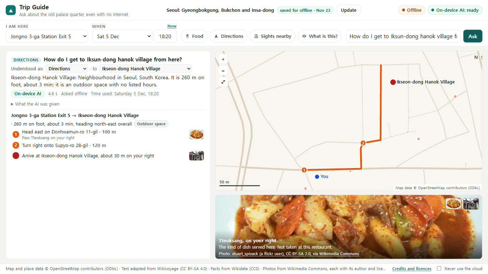
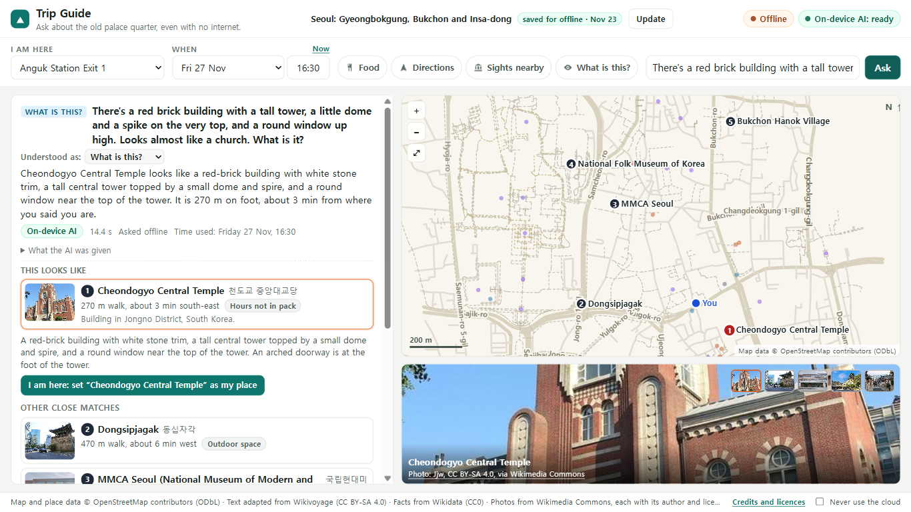
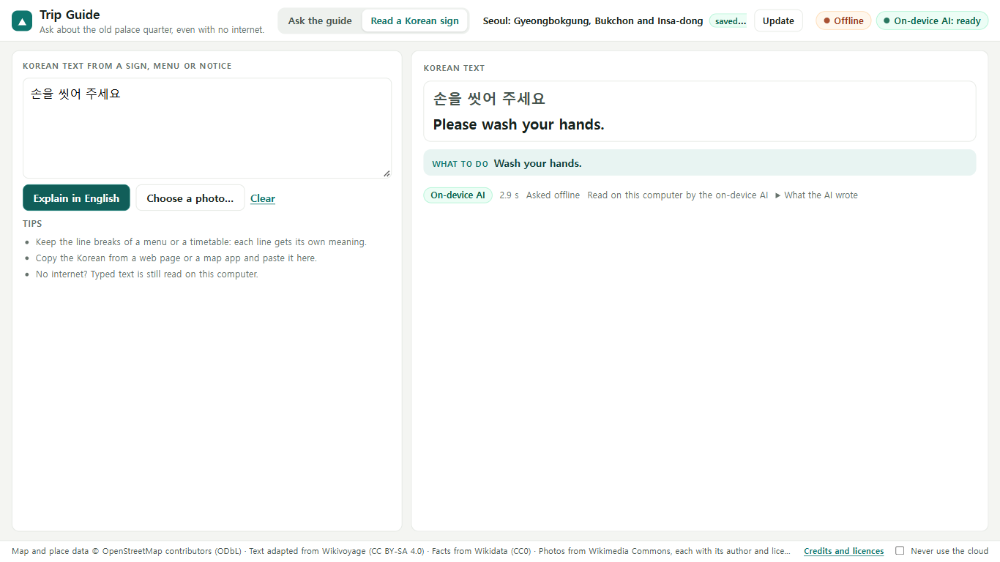
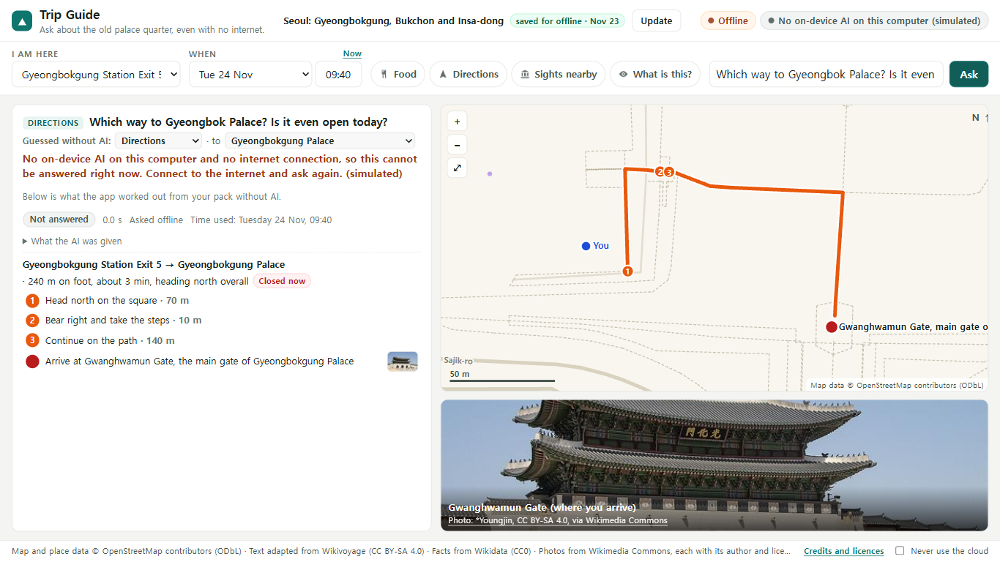

# Trip Guide

An offline travel guide for Seoul's old palace quarter (Gyeongbokgung, Bukchon and Insa-dong), for Chrome on
desktop. Before the trip you save a travel pack while you are online. On the trip, the AI built into Chrome answers
your questions from that pack on your own computer, even with no internet, and explains Korean signs, menus and
notices in English. A computer without the on-device model asks the cloud instead whenever it is online. Every AI
request goes through **Firebase AI Logic** hybrid inference.

Built for the Firebase #BuildHybridAI hackathon (platform: Chrome on desktop). An experimental Android build of the
same app is in `app-android/`; it is not the submitted platform (see "Android build (experimental)" below).

- Try it: <https://buildhybridai-2026-4e5fc.web.app> (Chrome on desktop; the address opens `/trip`)
- Demo video (2 minutes, recorded with Chrome's "Gemma 4 for Built-in AI" flag on): <https://youtu.be/E0dr_M5MLp0>



## The problem

A traveller abroad may have no data plan, a weak signal, or a connection that comes and goes, and still needs a
guide: "Where can I eat near here?", "How do I walk to the palace from this exit?", "What is that red brick
building?", "What does this menu say?". An AI assistant in the cloud cannot answer without a connection. Chrome on
desktop can run a small model on the computer itself (on hardware that meets its requirements), so these questions
can be answered where the traveller is, from data saved before the trip, without sending the question anywhere.

## What it does

The page has two tabs: **Ask the guide** and **Read a Korean sign**. (The guide screenshots were taken on
23 Nov 2026, before the tabs were added to the top bar.)

### Ask the guide

1. **Save for offline** (online, before the trip). The browser keeps the app, the Firebase AI Logic SDK and the
   travel pack: 61 places, opening hours, a walking network and 58 photos, 4.3 MB in all.
2. **Say where you are.** The app never asks for your location, so you pick "I am here" (a station exit, a
   gate, a street) and the day and time.
3. **Ask in English.** Four kinds of question: food near you, directions, sights nearby, and "What is this?"
   (describe what you see). You can type freely; the buttons are only shortcuts.
4. **Read one screen.** The answer, walking steps, a map drawn from the pack, photos with their credits, and a
   badge that says where the answer was made: **On-device AI**, **Cloud AI**, or **Not answered**.
5. **Fix a misunderstanding in one click.** Above every answer the app shows what it understood
   ("Understood as: Directions · to Ikseon-dong Hanok Village"). Changing the kind or the place answers again from
   the pack at once, without AI.

If something is not in the pack, the app says so ("Your saved travel pack does not include …") and offers the
closest names instead of answering about another place.



### Read a Korean sign

Paste or type the Korean words from a sign, menu or notice (keep the line breaks of a menu), or choose a photo of
it. The card shows every Korean line with its meaning in English, keeps prices in won, and ends with a short
**What to do** line. The same badge says which AI read it. The app has no camera access; a photo is a file you
choose.



## How the hybrid inference works

### One question to the guide

| Step | Who | What |
|---|---|---|
| 1. Read the question | AI (on device, or cloud when there is no on-device model) | Turns the question into a short form: kind, place name as written, start of a route, food, time ("now"), a second question. Prompt and JSON schema: `app/src/engine/trip/prompts.js` |
| 2. Match the place | Code | Matches the name to the pack: case, hyphens, possessives, spelling variants of Korean names, one or two wrong letters, initials (MMCA). `app/src/engine/trip/names.js` |
| 3. Work out the answer | Code | Walking route, steps, distances, opening state at the chosen time, nearest places, candidates for "What is this?". `app/src/engine/trip/guide.js`, `route.js`, `hours.js` |
| 4. Second AI call (only some questions) | AI | Picks the matching place among the candidates for "What is this?", or words an answer about one place's other facts |
| 5. Show it | Code | Answer, "Understood as" line, steps, map, photos, credits, badge. `app/src/ui/trip.js` |

The AI does the language work it is good at (reading a loose question, picking from a short list). Facts the
traveller relies on (distances, directions, opening hours) are computed by code from the pack, so the small
on-device model has little room to make them up.

### Where each guide request runs

The engine decides before every request, in under a second (`decide()` in `app/src/engine/index.js`):

| On-device model | Internet | "Never use the cloud" | Runs | Badge |
|---|---|---|---|---|
| available | yes | off | on this computer (`InferenceMode.PREFER_ON_DEVICE`) | On-device AI |
| available | no | any | on this computer (`InferenceMode.ONLY_ON_DEVICE`); nothing is started for the cloud | On-device AI |
| not available | yes | off | cloud (`InferenceMode.ONLY_IN_CLOUD`, model `gemini-3.5-flash-lite`) | Cloud AI |
| not available | no | any | nowhere; no request is tried, the app says why at once and shows a code-only guess | Not answered |
| not available | any | on | nowhere; nothing is sent | Not answered |

Also: input too long for the on-device model goes to the cloud; Chrome's unknown on-device error is retried once
and then goes to the cloud; an on-device answer that cannot be used (not the form asked for, far too long, or
breaking the form's own rules) is asked once more on the same device; two cloud requests for one question are kept
6.5 s apart (free tier). The full rule is in `app/docs/trip-routing.md`.

### Where each sign reader request runs

The sign reader uses the same engine and the same three inference modes (`runText()` in
`app/src/engine/index.js`, the task in `app/src/engine/tasks/sign.js`). Which AI tries first depends on what we
measured each one to do well (results below):

| Input | Online, cloud allowed | Offline, or "Never use the cloud" on |
|---|---|---|
| One line of text | this computer first (`PREFER_ON_DEVICE`); the cloud only if the device cannot answer | this computer (`ONLY_ON_DEVICE`) |
| Two or more lines (a menu, a notice) | cloud first (`ONLY_IN_CLOUD`); this computer if the cloud fails | this computer, with a note that dish names may be explained less well |
| A photo | cloud (`ONLY_IN_CLOUD`) | not read; the app asks you to type or paste the words, which works offline |
| Anything, no on-device model | cloud | a notice; nothing is sent |

The AI answers in plain text, one numbered line per Korean line and a last "To do:" line. It is not asked for JSON
or screen code; the app parses the lines and draws the card itself (`readText()` in `sign.js`, `app/src/ui/read.js`).
For typed text read on this computer, that line shape is held with a regular expression (`textConstraint` in
`sign.js`, passed as `responseConstraint`).

### Where Firebase AI Logic is imported and called

| File and line | What |
|---|---|
| `app/src/engine/sdk.js:4-5` | Imports `initializeApp`, `getAI`, `getGenerativeModel`, `GoogleAIBackend`, `InferenceMode` from the Firebase JS SDK 13.3.0 (official CDN, no build step) |
| `app/src/engine/cloud.js:15-28` | Firebase app with App Check (reCAPTCHA Enterprise), then `getAI(app, { backend: new GoogleAIBackend() })` |
| `app/src/engine/index.js:276-280` | A second Firebase app without App Check for on-device-only requests, so an offline page contacts no one |
| `app/src/engine/index.js:290`, `:297`, `:300` | Guide: `getGenerativeModel(…)` with `InferenceMode.ONLY_ON_DEVICE`, `PREFER_ON_DEVICE` (`onDeviceParams` and `inCloudParams`) or `ONLY_IN_CLOUD`, all with the same JSON schema |
| `app/src/engine/index.js:318`, `:324`, `:327` | Sign reader: the same three modes for plain text, with image input declared for photos |
| `app/src/engine/index.js:80`, `:100` | `model.generateContentStream(…)` for every question and every sign reading (text, or text and an inline photo) |
| `app/src/engine/index.js:251` | One short warm-up request through the same SDK call when the page opens and the on-device model is available |
| `app/src/engine/index.js:93`, `:115` | Reads `response.inferenceSource` (`on_device` / `in_cloud`) for the badge |
| `app/src/engine/index.js:346`, `:376`, `:420` | `decide()`, `askOnce()` (reading the question) and `process()` (the whole guide question) |
| `app/src/engine/index.js:661` | `runText()`: the sign reader's order of tries |

On-device output of the guide is held to a JSON schema with `responseConstraint`, with a `maxLength` on every
free-text field so the model cannot write on and on inside one field; cloud output uses `responseJsonSchema` (the
same schema without the length limits). The app never sends a prompt to Chrome's model itself: there is no direct
`prompt()` or `promptStreaming()` call outside the SDK. Outside the SDK it asks `LanguageModel.availability()`,
measures the input size, and, in `app/src/engine/session-store.js`, prepares one on-device session per set of
options and hands the SDK clones of it, so the model does not re-read the instructions on every request. The request
itself, streaming and `inferenceSource` stay inside the SDK; `?store=off` turns the session store off.

### Offline start

`app/sw-trip.js` is a service worker for the trip page only. App files are network first with a saved copy when
there is no connection; the three Firebase SDK files are cache first (their URLs carry a fixed version); pack
files are saved by "Save for offline". The page is kept under its clean address `/trip`: Firebase Hosting
answers `/trip.html` with a redirect, and a redirected response cannot be used to open a page offline. While
offline the engine does not start App Check or reCAPTCHA.

## Measured results

All on one Windows PC (6-core CPU, 31 GB RAM, integrated graphics, which Chrome rates "Medium"), Chrome 157 and,
for the runs of the evening of 26 Nov, Chrome 158, window 1366×768. The on-device model is Chrome's default one
unless a table says otherwise. "Network cut" means offline emulation plus blocking every request that leaves the
computer. The cloud path was measured with the on-device model switched off in the app (`?simulate=no-model`) or in
a browser without the model.

### The guide (23 Nov 2026)

- **Questions.** 25 questions written by a separate helper that saw only the travel pack and its format document,
  not the app code: 5 each for food, directions, sights nearby and "What is this?", and 5 asking for things the
  pack does not have. Typos, lower case, roundabout wording and two questions in one sentence are mixed in. The
  questions are in `app/test/data/guide-judge3.json`.
- **Frozen code.** File hashes were recorded before the questions were opened. Both main runs had the network cut.
- **Earlier rounds.** This was the third round that day. The first two, each with its own new set of 25 questions
  and two runs, scored 15/20 and 15/20 on answer quality against the same bar of 16: **not passed** both times.
  After the second we moved the reading of the question from word rules to the AI. Each round used questions the
  code had not seen.

| Check | Bar | Run 1 | Run 2 | Result |
|---|---|---|---|---|
| Answer quality (20 answerable questions) | 16+ correct in both runs, 3+ of 5 for each kind | 18/20 | 16/20 | passed |
| Nothing invented (5 questions about things not in the pack) | 0 invented answers in both runs | 0 invented; 4 said "not in the pack" in the first sentence; 1 answered with a nearby fact | 1 invented (a rental shop question answered with distances to tea houses) | **not passed** |
| Directions (5 route questions) | right destination, street order and map route in all 5, both runs | 4/5 | 4/5 | **not passed** (one question "from A to B" was read as "to A") |
| Speed | median time per question 10 s or less | 4.4 s (max 17.2 s) | 4.5 s (max 18.2 s) | passed |
| Works with no internet | 25/25 answered on device, map shown, photo rule met; 0 requests out | 25/25, 0 requests succeeded outside the computer | same | passed |
| Cloud fallback, online, no on-device model | every question answered by the cloud | 25/25 Cloud AI, median 0.9 s | 25/25, median 1.0 s | passed |
| No on-device model and no internet | clear notice within 1 s, no request tried | 25/25 notice, slowest 33 ms | 25/25, slowest 36 ms | passed |
| One screen (1366×768) | all route steps, map route, photo and credit line visible without scrolling | 5/5 | 5/5 | passed |
| Rules | 0 direct `prompt()` calls; secret scan clean; all 58 photos credited | 0; clean; 58/58 | | passed |

Time per question, on device: reading the question took a median of 4.2 s (run 1) and 4.3 s (run 2); everything
the code did after that took about 0.02 s. "What is this?" needs a second AI call and took 14 to 18 s.

### The guide after later fixes (26 Nov 2026)

Since then we changed how questions are read (the "from A to B" order; words such as "near me", "from here" or
"art museum" taken as place names) and ran the same 25 questions again, network cut, two runs each, counting all
25 answers:

| Code | Bar | Run 1 | Run 2 | "Not in the pack" | Median | Result |
|---|---|---|---|---|---|---|
| 26 Nov, before the last fix | 23/25 in both runs | 24/25 | 24/25 | 5/5, 5/5 | 5.1 s, 4.6 s | passed |
| 26 Nov, after the last of these fixes (v7; v8, online until that evening, has the same engine) | 24/25 in both runs | 25/25 | 23/25 | 5/5, 5/5 | 4.8 s, 5.0 s | **not passed** (run 2 missed two questions that the code before the fix also missed) |

New questions written before each fix, network cut: 6/6 "near me / from here" questions with both versions, and
6/6 questions with a kind of place but no name ("is there an art museum somewhere close by?") with v7 (3/6 before
the last fix). These two small sets are not part of this repository. The version online now (v9) was measured
again on these 25 questions; see "Both of Chrome's on-device models" below.

### Read a Korean sign (24 and 26 Nov 2026)

Test items: 20 one-line signs and notices, 10 menus and notices of several lines, and 10 photos of real signs and
menus. "Right" means the English meaning is right and prices and times are kept; a dish given only by its
romanized Korean name counts as wrong.

| Check | Bar | Result | |
|---|---|---|---|
| One line, on device, network cut | 18/20 right, median 5 s or less | 18/20, median 2.7 s, 0 requests out | passed |
| Several lines, on device, network cut | 8/10 right | 5/10 (four gave dish names only in romanized Korean, one read a no-smoking notice the wrong way round) | **not passed** |
| Several lines, cloud, on the hosted site, browser without the model | 8/10 right, median 6 s or less | 10/10, median 4.8 s | passed |
| Photos, cloud | 8/10 right, no answer with invented lines, median 6 s or less | 8/10, 0 invented, median 1.7 s | passed |
| Photos, on device, network cut | 6/10 right, at most 1 answer with invented lines | 4/10 with 2 invented; after one prompt fix 5/10 with 1 | **not passed** |
| Phone width (375 px) | no sideways scrolling | none on the first screen, a route answer and the sign card (not tried on a real phone) | passed |

The two failed rows decided the routing above: menus go to the cloud first while online, and photos are not read
offline (`devicePhotos: false` in `sign.js`; the on-device photo prompt is kept).

### Both of Chrome's on-device models (26 Nov 2026)

Chrome can answer the Prompt API with two on-device models. On our PC the default was its Gemini Nano model
(listed as `nano_v3` in `chrome://on-device-internals`). With `chrome://flags/#gemma4-for-built-in-ai`
("Gemma 4 for Built-in AI") set to Enabled, which the hackathon FAQ gives as the way to use Gemini Nano 4 in
Chrome, the same API is answered by Gemma 4. The app does not choose or check the model: it uses whichever one
Chrome gives through Firebase AI Logic. Every table above was measured with the default model.

On 26 Nov we measured the version then online (v8) with the flag on and the network cut, and it did worse there:
the route question shown in the video was answered right in 3 of 5 tries (once the model wrote on for 58 s inside
one field until the app cut it, once it returned mixed-script text), the 25 questions scored 23/25 and the one-line
signs 15/20. A web page cannot set the sampling (temperature, top-K) of Chrome's model, so we bounded the answers
instead: a `maxLength` on every free-text field of the JSON schema, a regular expression for the sign reader's
lines, and one more try on the same device when an answer cannot be used (`app/docs/trip-routing.md`, "Both
on-device models"). That version, v9 (service worker `trip-app-v9`), is the one online now. We measured it on both
models with the same questions, network cut, on the local server:

| Check | Bar | Gemma 4 flag on | Default model |
|---|---|---|---|
| The video's three questions (a route, sights nearby, a one-line sign) | flag on: 9 of 10, 5 of 5, 9 of 10; default: 5 of 5 each | 10/10, 5/5 (10/10 counting every run), 10/10; slowest answer 8.7 s; passed | 5/5, 5/5, 5/5; passed |
| The 25 guide questions, one run | 23/25, "not in the pack" 5/5, median 10 s or less | 25/25, 5/5, median 6.1 s (slowest 18.5 s); passed | 24/25, 5/5, median 2.9 s (slowest 51.4 s); passed |
| The 20 one-line signs | 17/20 right | 16/20, median 6.3 s; **not passed** | 19/20, median 3.0 s; passed |

The four signs missed with Gemma 4 were wrong word meanings (for example a door sign that says "pull" was
explained as "Please wait here", and "sold out" as "Jin"). The answer shape cannot prevent that, and we did not add
the test words to the prompt. With the default model, the 51.4 s answer was a reply that ran long, was cut by the app and
asked again. Online, the cloud path of v9 answered 2 of 2 menu readings, and 2 of 2 route questions with the model
switched off (`?simulate=no-model`).

After v9 went online we ran the video's questions again on the hosted site. Network cut: 5/5 (route), 3/3 (sights)
and 5/5 (sign) with the Gemma 4 flag on, and 3/3 each with the default model, all answered on the computer with 0
requests out. Online: 2/2 menu readings and 2/2 route questions with the model switched off, all by the cloud. A
browser that had saved v8 kept only `trip-app-v9` after opening the page online and reloading it once; the saved
travel pack stayed.



## Run it yourself

### You need

- Chrome on desktop with the built-in Prompt API and its on-device model. When we read Chrome's
  [Get started page](https://developer.chrome.com/docs/ai/get-started) (Nov 2026) it listed: Chrome 148 or later on
  the web, a GPU with more than 4 GB of memory or 16 GB RAM with 4 CPU cores, and 22 GB free on the drive of the
  Chrome profile. We tested Chrome 157 and 158, with the default model and with the flag
  `chrome://flags/#gemma4-for-built-in-ai` set to Enabled (Gemma 4; relaunch Chrome after changing it). Without a
  model the app still works online through the cloud.
- Node.js 20 or later (only for the small local server and the checks).
- Your own Firebase project with Firebase AI Logic (Gemini Developer API) and App Check.

### Steps

From the root of this repository:

1. Make your own settings file from the template:
   ```sh
   mkdir app/local
   cp app/firebase-config.example.js app/local/firebase-config.js
   ```
   Fill in **your own** Firebase web app settings in `app/local/firebase-config.js`. For local development,
   register an App Check debug token in the Firebase console (App Check > Apps > Manage debug tokens) and put it in
   `appCheckDebugToken`. `app/local/` is git-ignored; never commit it.
2. Start the server:
   ```sh
   cd app
   node tools/serve.mjs
   ```
3. Open <http://localhost:8790/trip> in Chrome. To try the app the way Firebase Hosting serves it (`/` and
   `/trip.html` redirect to `/trip`, the `firebase.json` headers apply), run `node tools/serve.mjs --hosting` instead
   and open <http://localhost:8791/trip>.
4. While online, press **Save for offline**. Then turn the network off and ask a question, or open
   **Read a Korean sign** and paste one line of Korean.

Useful switches: `?simulate=no-model` behaves as if the computer had no on-device model (to see the cloud path);
the **Never use the cloud** switch (or `?deviceOnly=1`) keeps every request on the computer. `app/README.md` lists
the switches of the trip page.

Checks without AI, from the root of this repository:

```sh
node app/test/names.test.mjs     # place-name matching
node app/test/sign.test.mjs      # reading the sign reader's answers into card lines
node app/tools/scan-secrets.mjs  # keys, tokens and direct prompt() calls
```

`scan-secrets.mjs` checks the files git would commit, so run it in a git checkout. It also looks for the values of
your `app/local/firebase-config.js` in those files: run it after you have filled in your own settings (with the
template copied unchanged, it finds the template's own placeholder values).

To rebuild the travel pack from the open data, see `data-src/README.md`.

### Deploying

`app/firebase.json` serves `app/` with Firebase Hosting. For a public site, register a reCAPTCHA Enterprise key
for your domain in App Check, put it in `recaptchaSiteKey`, and leave `appCheckDebugToken` empty.
`app/local/firebase-config.js` is uploaded with the site (the page needs the Firebase web settings), so anything
in it is public once deployed: it must never hold a debug token. The page lives at `/trip`, and `/` redirects there.
The `ignore` list keeps tools, tests and docs off the site; it also names files of earlier prototypes that are not
in this repository. Those prototypes were earlier tries for this hackathon, written during the submission period
like everything here (the first commit of the project is from 16 Nov 2026).

## Android build (experimental)

`app-android/` is an experimental Android build of the same app. It is not the platform submitted to the hackathon.
The submitted platform is Web (Chrome on desktop), and everything else in this README is about that version.

**What it is.** The Android app shows the same trip page in a WebView and runs the same engine. At build time the
page, the engine and the travel pack are copied from `app/` into the APK, so the pack is inside the app and there is
no "Save for offline" step and no service worker. One engine file is replaced, `app/src/engine/sdk.js`:
`app-android/web/sdk.js` hands every AI request to a Kotlin bridge (`AiBridge.kt`), which calls the Firebase AI Logic
Android SDK (`firebase-ai` 18.2.0 and `firebase-ai-ondevice` 16.0.0-beta08) and passes back the `inferenceSource`
that SDK reports. A few words on the screen are changed ("this computer" becomes "this phone"), and
`app-android/web/README.md` lists every change. The WebView blocks requests to any host other than the app's own
files.

**How to build it.** `app-android/README.md` has the steps. In short: JDK 21, the Android SDK (platform 37), and your
own Firebase project with Firebase AI Logic and App Check. Register an Android app with the package name
`app.tripguide.hybrid` there and put its `google-services.json` into `app-android/app/`; that file is git-ignored and
not in this repository. A debug build uses the App Check debug provider, so register the debug token of your install
in your own Firebase console. Then run `./gradlew assembleDebug` in `app-android/`. This repository holds the source
only: no APK, no `google-services.json`, no token.

**What we measured (26 Nov 2026).** One phone, a Samsung Galaxy S26 FE (model SM-S741N, API level 37) used remotely
through Samsung's Remote Test Lab, with an APK built from the v8 web code (not the v9 code that is online now and in
this repository). On that phone the SDK reported no on-device model (`UNAVAILABLE` for both the preview and the
stable option), so only the cloud path and the behaviour with no internet could be measured.

| Check | Result |
|---|---|
| Online, 4 inputs, 3 runs each: a route question, a sights question, a one-line sign, a three-line menu | 12 of 12 gave the expected answer with the label "Cloud AI"; the SDK reported `IN_CLOUD` for all 12 |
| Airplane mode, 3 runs: open the app, then ask the route question | 3 of 3: the app opened and listed the 61 places with the map; the question got the notice "No on-device AI on this phone and no internet connection, so this cannot be answered right now."; no AI request was made and the WebView had no outside request to block. A loaded photo was recorded on opening in 2 of the 3 runs |

The expected answers are the ones we used for the same four inputs in the web version. Six earlier airplane-mode runs
were cut short by a screenshot timeout in our test driver before any question was asked; in those the app had also
opened with the 61 places and made no AI request.

**What we did not measure.**

- The on-device path on a phone. We had no phone on which the SDK reported an on-device model, so this build has not
  produced an answer labelled "On-device AI" on a phone. Choosing and downloading the Gemini Nano model, asking for
  JSON in the system instruction, and the 4000-token limit are written from the SDK documentation and are untested
  on a device.
- The v9 engine on a phone. On 26 Nov we rebuilt the Android app with the v9 web code in this repository. The rebuild
  needed one fix in `app-android/web/sdk.js`: the v9 engine gives the sign reader's on-device request a regular
  expression as the answer shape, which only Chrome understands. The bridge no longer passes it on, so on Android
  that shape is not enforced. The PC tests pass (13 tests with a made-up bridge, no phone and no AI call), but this
  APK has not been installed or run on any phone.
- Photos in the sign reader, any other phone or Android version, and battery or memory use.

The scripts that drove the phone, the raw logs and the screen recordings are not in this repository.

## Known limits

- Two of our own bars for the guide were not met (tables above): one invented answer in 10 tries at questions about
  things not in the pack, and one route question in 5 read the wrong way round on 23 Nov; after the later fixes,
  23/25 in one of two runs against a bar of 24.
- The on-device model does not always read the same question the same way: three of the 25 questions were read
  differently in run 1 and run 2 on 23 Nov. The code filters what it can (names not written in the question are
  dropped, "now" without a time word is dropped), but it cannot remove this.
- "What is this?" needs two AI calls: with v9 it took about 10 to 12 s on the default model and about 18 s with
  Gemma 4.
- With the "Gemma 4 for Built-in AI" flag on, answers took about twice as long as with the default model (median
  6.1 s against 2.9 s for guide questions), and one-line signs were 16/20 against our bar of 17: a single word on a
  sign is sometimes given a wrong meaning.
- Sign reader: photos need an internet connection, and menus read on this computer (offline, or with "Never use the
  cloud" on) may give dish names without a good English explanation. Korean is not among the input languages
  Chrome's on-device model lists, so the app declares English input and output; the results above are what that
  gave.
- One area (61 places). Opening hours were checked on official websites on 23 Nov 2026 and can change.
- The guide answers in English. Korean names are shown next to English ones to help match street signs.
- With no on-device model and no internet, the question cannot be read; the app says so and shows a guess made by
  simple word rules, which the traveller can correct with the menus.
- The app does not start the on-device model download (several GB); if Chrome reports the model as downloadable,
  the pill says "On-device AI not installed" and the app uses the cloud while online. Chrome's documentation says
  the download starts when a page creates a Prompt API session after a user action (`LanguageModel.create()`),
  for example from the DevTools console; `LanguageModel.availability()` then returns "available" and the pill turns
  to "ready" after a reload. Our test computer already had both models, so we did not test the download step.
- A question with two parts gets an answer to the first part and a button to ask the second.

## Privacy

With the on-device model, questions and sign text stay on the computer. Text or photos go to the cloud AI (the
Gemini Developer API through Firebase AI Logic, protected by App Check) only in the cloud cases of the tables above.
With **Never use the cloud** on, nothing is sent, and while offline the page does not start App Check or reCAPTCHA.

## Data and licences

The code is under the Apache License 2.0 (`LICENSE`). The travel data are not: places, paths and the map come
from OpenStreetMap (© OpenStreetMap contributors, ODbL 1.0), place descriptions are adapted from Wikivoyage
(CC BY-SA 4.0), basic facts from Wikidata (CC0), photos from Wikimedia Commons (each with its own author and
licence). The travel pack is a derived database of OpenStreetMap data under the ODbL 1.0, and the way it was made
is in `data-src/`. Every source, licence and photo author is in `CREDITS.md`; the app shows the same credits on
screen. No logos are used.

## Project layout

```text
app/trip.html                    The app page (two tabs: Ask the guide, Read a Korean sign)
app/sw-trip.js                   Service worker for offline use
app/firebase.json                Firebase Hosting settings
app/firebase-config.example.js   Template for app/local/firebase-config.js (your own settings, not in the repo)
app/src/engine/index.js          Hybrid engine: decide where to run, call Firebase AI Logic, fall back
app/src/engine/sdk.js            Firebase JS SDK imports (13.3.0, official CDN)
app/src/engine/cloud.js          Cloud side with App Check
app/src/engine/session-store.js  Reuse of a prepared on-device session
app/src/engine/tasks/trip.js     The guide task: reading the question, answer shape
app/src/engine/tasks/sign.js     The sign reader task: prompts, order of tries, reading the answer into card lines
app/src/engine/trip/             Code facts: names, routes, hours, picking places, prompts
app/src/ui/                      Page (trip.js), sign reader (read.js), map and styles
app/packs/                       Travel pack (JSON) and its 58 photos
app/docs/                        Pack format, routing rule, screenshots
app/test/                        Place-name and sign reader tests, and the 25 measured guide questions
app/tools/                       Local server (simple, or like Firebase Hosting) and secret scan
app/README.md                    Running and deploying the app
data-src/                        Open data and scripts that build the pack
app-android/                     Experimental Android build: the same page in a WebView, AI through the Firebase AI Logic Android SDK
```
